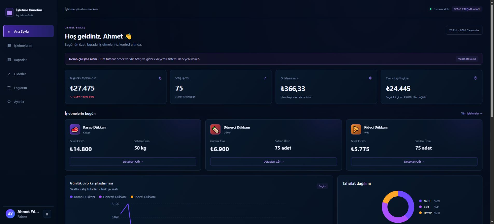

  <a href="https://mukasoft.com.tr"><strong>MukaSoft</strong></a>
  &nbsp; · &nbsp;
  <a href="https://mukasoft.com.tr/calismalarimiz.php">Çalışmalar</a>
  &nbsp; · &nbsp;
  <a href="https://mukasoft-isletme-demo.onrender.com">Canlı demo</a>

## Merhaba, ben Muhammet.

**MukaSoft** çatısı altında web uygulamaları ve işletmelere özel yönetim panelleri geliştiriyorum. Fikirlerin kullanılabilir bir arayüze, çalışan bir altyapıya ve denenebilir bir ürüne dönüşmesiyle ilgileniyorum.

`Next.js` `React` `TypeScript` `Laravel` `Node.js` `SQL` `Docker`

### Odaklandığım alanlar

- **Web uygulamaları:** kullanıcı deneyimi, mobil uyumlu arayüzler ve yönetim ekranları.
- **İşletme araçları:** satış, ciro, gider takibi ve kullanıcı yetkilendirme.
- **Yapay zekâ:** günlük iş akışlarına katkı sağlayan pratik entegrasyonlar.

### Ürün vitrini · İşletme Panelim

Satışları, işletme giderlerini ve ciroyu tek panelde takip etmek için geliştirdiğim web uygulaması.

| Müşteri paneli | Genel yönetim |
| --- | --- |
| Satış girişi ve ödeme türleri | Müşteri çalışma alanları |
| Günlük, haftalık ve aylık ciro raporları | Kullanıcı ve rol yönetimi |
| Gider takibi ve CSV rapor çıktısı | Şifre sıfırlama ve abonelik erişimi |

**Node.js · Express · SQLite · JavaScript**

[**Demoyu incele →**](https://mukasoft-isletme-demo.onrender.com)

Demo hakkında

Giriş ekranındaki **Demo panelini keşfet** düğmesiyle örnek verileri inceleyebilirsiniz. Ücretsiz sunucu uykuya geçtiğinde ilk açılış gecikebilir; yeniden başlatıldığında eklenen deneme kayıtları sıfırlanabilir.

---

### Bir proje fikrin mi var?

Web uygulaması veya işletmene özel bir yönetim paneli için [**MukaSoft'u ziyaret et →**](https://mukasoft.com.tr)
